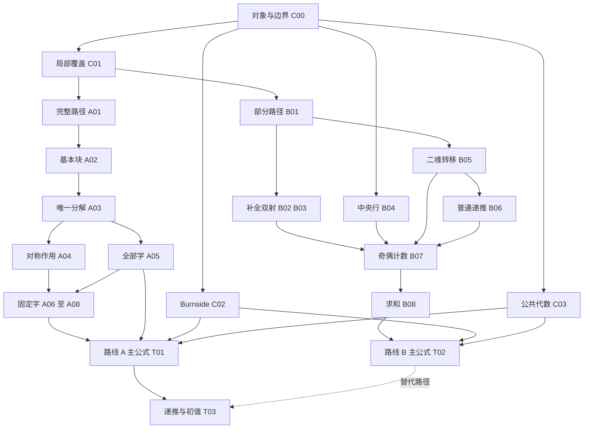

# 三行主定理的逐项证明链

> 历史书面审读记录的公开副本。正文中的“未形式化”描述本记录形成时的范围；当前 M1–M11 已通过，见 [当前进度](../progress.md)和[覆盖表](../coverage.json)。来源是研究工作区原证明链，发布仅调整阅读路径；本记录自身不是 Lean 证书。

日期：2026-10-25。对象：P002 三行主定理的两条组合论证及其共同代数结尾。用途：供读者逐项审查，不替代原稿，也不修改原中文论文。

**结论与状态：**本轮已把论证拆成 24 个节点，核对下列陈述、依赖、证明位置及四个重点环节，未识别出具体反例、循环依赖或必须新增的未证数学前提。这是同一助手的书面审读与明确范围的程序检查；不是外部同行评议，也不是 Lean 验证。研究尚未完成，不据此宣称已经解决猜想。问题的公开状态和文献优先权本轮没有重新核查，仍不能作“首次解决”判断。

## 1. 原命题、约定与目标

对每个整数 $n\ge1$，令 $\mathcal T_n$ 为 $3\times2n$ 单位方格矩形的所有完整多米诺铺法。每块砖是**两个共边格子的无序对**；一个铺法是这些无序对组成的集合，每格恰被覆盖一次。砖无标号，允许横、竖两种方向，没有 tatami 条件。不能把砖的端点次序或放置次序计入铺法数。

使用一基坐标 $1\le r\le3$、$1\le c\le2n$，定义

$$h(r,c)=(4-r,c),\qquad v(r,c)=(r,2n+1-c),\qquad\rho=hv.$$

因为 $3\ne2n$，非空矩形的完整几何对称群恰为 $G=\{e,h,v,\rho\}\cong C_2\times C_2$。对砖和铺法逐点作用，保持邻接及完整覆盖。定义 $a(n)=|\mathcal T_n/G|$。

$n=0$ 时**另行规定** $\mathcal T_0=\{\varnothing\}$，让抽象四元群平凡地作用于此单元素集合，故 $a(0)=1$。不把空几何区域的全体几何对称说成只有四个。有限群作用不要求忠实。

记 $d_n=|\mathcal T_n|$，$h_n,v_n,r_n$ 为三个非恒等元素的固定点数。$D,H,V,R,A$ 分别为这些序列的生成函数。全部运算在 $\mathbb Q[[x]]$ 中进行，指数 $n$ 始终表示**半宽**。

本轮实际目标是审核下式的证明链，而非新增推广：

$$A(x)=\sum_{n\ge0}a(n)x^n
=\frac{N(x)}{(1-x)P(x)Q(x)},$$

其中

$$P=1-4x+x^2,\quad Q=1-4x^2+x^4,\quad
N=1-3x-4x^2+10x^3-4x^5+x^6.$$

这是 [原题](../../../docs/zh/statement.md) 的同一有理式：将分子分母同时乘 $-1$ 即得另一符号约定。七阶递推和初值是结论，不能当作任何组合步骤的前提。五行、一般奇数高度、稳定子细分及渐近结论不在本轮审查范围内。

## 2. 如何阅读核验状态和证明位置

- **W（书面）**：本轮逐步检查给出的任意尺寸论证，未发现缺口。并非机器证明或外部认证。
- **F（有限）**：本轮新脚本实际检查所列有限对象。不能由此推出全部 $n$ 或全部 $k$。
- **S（符号）**：对明列的多项式、有理式或矩阵式进行了精确符号运算。只证明该代数等式，不自动证明其几何建模。
- **Lean：所有节点均未形式化验证。**定义节点仅核对约定；脚本的 DAG 检查只针对人工登记的依赖，不能自动发现证明文字中所有隐含依赖。

下表中的文件简称均指本轮读取的真实来源，节号或 TeX 标签是主要定位方式；精确行号与 SHA-256 另见 本轮报告（原工作区保存，未随此副本发布）。不依赖可能随排版变化的 PDF 页码。

| 简称 | 来源 |
| --- | --- |
| P1 | [A001 证明草稿](../../../docs/zh/blocks-proof.md) |
| P2 | [A002 证明草稿](../../../docs/zh/half-board-proof.md) |
| EI | [公开材料英文稿 introduction.tex](../../../papers/en/sections/introduction.tex) |
| EB | [公开材料英文稿 blocks.tex](../../../papers/en/sections/blocks.tex) |
| EH | [公开材料英文稿 half-board.tex](../../../papers/en/sections/half-board.tex) |

机器可读登记见 [claims.json](claims.json)，可复现程序见 check_chain.py（原工作区保存，未随此副本发布）。节点是对现有 L001—L009 的细分，不另设一套未经登记的共享数学前提。

## 3. 陈述—依赖—证明位置—核验状态

### 3.1 共同基础

| 节点 | 陈述 | 直接依赖 | 证明位置 | 核验状态 |
| --- | --- | --- | --- | --- |
| C00 | 第 1 节的对象、四元群、空对象、半宽和形式幂级数约定 | 定义 | P1 §1；EI `sec:intro` | 定义核对；F：$n=0,1$ 边界 |
| C01 | 三行局部覆盖当且仅当输入输出不交且剩余行是空集、$\{1,2\}$ 或 $\{2,3\}$；竖直补全唯一 | C00 | P1 §2，L001；EB `eq:local3`、`tab:states` | W；F：全部 64 个状态对、12 条合法边 |
| C02 | $a(n)=(d_n+h_n+v_n+r_n)/4$，包括非忠实作用与 $n=0$ | C00、有限群轨道稳定子计数 | P1 §7，L006；EI `lem:burnside` | W：逐轨道贡献 4；F：直接轨道与平均相符，$n\le5$ |
| C03 | $[(1-x)^2Q+PQ+2(1+2x-x^3)(1-x)P]/4=N$ | C00 的代数约定 | P1 §7；EB `eq:average-rational` 后通分段；本文件 §8 | W；S：精确多项式零残差 |

### 3.2 路线 A：切口、基本块和固定字

| 节点 | 陈述 | 直接依赖 | 证明位置 | 核验状态 |
| --- | --- | --- | --- | --- |
| A01 | 任意整数宽 $w\ge0$ 的完整铺法与从空状态到空状态的长度 $w$ 合法路径互逆 | C01 | P1 §2，L001；EB `lem:path`；本文件 §4 | W；F：780 个完整铺法与完整路径集合相等，逐个往返 |
| A02 | 非空无断口基本块恰为 $C$ 和每个 $k\ge1$ 的 $A_k,B_k$，穷尽且无重复 | A01 | P1 §3，L002；EB `lem:blocks`；本文件 §4 | W：三个首步分支及强制后继；F：$k=1,\ldots,5$ 的全部首次回空路径 |
| A03 | 沿全部断口切开与有限基本块字拼接互逆；空字对应空铺法 | A02（用于识别字母表）、断口定义 | P1 §4，L003；EB `lem:word`；本文件 §5 | W：边界与断口的两个包含关系；F：780 个字与铺法，两向往返 |
| A04 | $h$ 是字母对合 $\sigma$，$v$ 是倒序，$\rho$ 是二者复合，允许块宽不同 | A03、块的坐标定义 | P1 §5，L004；EB `eq:word-action` | W：逐坐标反射和断口集合保持；F：3120 次作用比较 |
| A05 | $F=x+2\sum_{k\ge1}x^k$；$D=(1-F)^{-1}=(1-x)/P$ | A03、权重可加 | P1 §4、§6；EB `eq:F`、`eq:DH` | W：每个系数只接收有限个字；S；F：小尺寸计数 |
| A06 | $h$ 固定字只有 $C^\ell$，所以 $H=(1-x)^{-1}$ | A04 | P1 §6，L005；EB `eq:DH` | W；F：各尺寸恰一个上下反射固定铺法 |
| A07 | $v$ 固定字唯一为 $U\operatorname{rev}(U)$ 或 $Ub\operatorname{rev}(U)$；$V=(1+F)D(x^2)$ | A04、A05 | P1 §6，L005；EB `eq:V` | W：按字长奇偶的互斥分类；F；S |
| A08 | $\rho$ 固定字唯一为 $U\sigma(\operatorname{rev}(U))$ 或 $UC\sigma(\operatorname{rev}(U))$；$R=(1+x)D(x^2)$ | A04、A05 | P1 §6，L005；EB `eq:R` | W：中心字母必须被 $\sigma$ 固定；F；S |

### 3.3 路线 B：半棋盘和二维递推

此表只取三行特例。原 L007、L008 允许更一般高度，本轮不借此自动认证所有推广。

| 节点 | 陈述 | 直接依赖 | 证明位置 | 核验状态 |
| --- | --- | --- | --- | --- |
| B01 | 末列留空集合为 $S$ 的部分铺法与末状态为 $S$ 的合法路径互逆，$q_\ell^{\mathsf T}=e_0^{\mathsf T}T_3^\ell$ | C01、部分铺法定义 | P2 §2；EH `eq:profile`；本文件 §6 | W；F：$\ell=0,\ldots,5$ 的全部 80 个部分对象与路径集合相等 |
| B02 | 任意终端 $S$ 都可左右反射补全；补全与限制构成到 $\operatorname{Fix}(v)$ 的双射 | B01 的对象 | P2 §3，L007；EH `lem:half`；本文件 §6.2 | W：良定义、两条逆等式；F：80 个定义域对象，两个方向与像集全查 |
| B03 | 半周补全当且仅当 $J(S)=S$；在该定义域上与 $\operatorname{Fix}(\rho)$ 双射 | B01 的对象 | P2 §3，L007；EH `eq:half-fixed`；本文件 §6.3 | W：必要、充分、两条逆等式；F：30 个合格对象，两个方向与像集全查 |
| B04 | 上下反射不允许竖直砖接触中央行，三行时 $h_n=1$ | C00、完整覆盖不重叠 | P2 §4，L008；EH `lem:h-odd` | W：中央行重叠排除，不假定每块砖逐块固定；F |
| B05 | $q_{2j}$ 的支持包含于 $\varnothing,\{1,2\},\{2,3\}$，两后者同为 $\beta_j$；$(\alpha_{j+1},\beta_{j+1})^{\mathsf T}=M(\alpha_j,\beta_j)^{\mathsf T}$ | B01 | P2 §6；EH `eq:two-dimensional`；本文件 §7 | W：初值与两步归纳；S：含符号 $\alpha,\beta$ 的两次转移恒等式 |
| B06 | $d_j=\alpha_j$；$d_0=1,d_1=3,d_{j+2}=4d_{j+1}-d_j$ 对所有 $j\ge0$ 成立 | B05 | P2 §6，L009；EH `eq:d-rec` | W；S：$M^2-4M+I=0$ |
| B07 | $r_{2j}=r_{2j+1}=d_j$，$v_{2j}=d_{j+1}-2d_j$，$v_{2j+1}=d_{j+1}$，$h_n=1$ | B02、B03、B04、B05、B06 | P2 §6，L009；EH `eq:parity-fixed` | W：终端求和与对称终端筛选；F：$n=0,\ldots,5$ |
| B08 | 从 B06、B07 求和，重新得到 $D=(1-x)/P$、$H=(1-x)^{-1}$、$R=(1+x)D(x^2)$、$V=(1+x)(D(x^2)-1)/x^2-2D(x^2)$ | B07（含 B06） | P2 §7；EH “Second proof of Theorem”；本文件 §7 | W：重编号及可整除性；S：与明列有理式相等 |

### 3.4 合流、递推及边界

| 节点 | 陈述 | 直接依赖 | 证明位置 | 核验状态 |
| --- | --- | --- | --- | --- |
| T01 | 路线 A 得到主生成函数 $A=N/((1-x)PQ)$ | C02、C03、A05—A08 | P1 §7；EB “First proof of Theorem” | W；S；F：$n\le5$ 的直接轨道计数 |
| T02 | 路线 B 得到同一主生成函数，无须使用基本块分类 | C02、C03、B08 | P2 §7；EH “Second proof of Theorem” | W；S；F：同上 |
| T03 | 分母系数推出 $n\ge7$ 的七阶递推，低阶系数给出七个初值 | T01 **或** T02；不是同时必需 | P1 §8；EI `eq:recurrence`；本文件 §8 | W；S：分母展开、初值 $a(0),\ldots,a(6)$ |
| T04 | 空棋盘、$k=1$ 基本块及小尺寸计数与各构造一致 | C00、A02、B07、T01 | P1 §8；EI `thm:main`；本文件 §9 | W：边界逐项说明；F：$n\le5$，$n=6$ 只作代数核对 |

精简依赖图如下，完整逐边清单见 JSON。C03 只是通分恒等式，不以主生成函数正确为前提。

**独立性的准确含义：**A002 不使用 A001 的分类、唯一分解或固定字结论。两条路线共用覆盖定义、局部规则、Burnside 和代数通分；英文第二证明明确引用第一证明最后的代数化简。将该纯代数恒等式单列为 C03 后，不存在用 T01 证明 T02、再用 T02 证明 T01 的循环。不能把“组合路线不同”写成“全部基础完全独立”，更不能写成不同作者的独立认证。

## 4. 重点一：基本块分类为什么穷尽

### 4.1 先核对全部局部情形

在任意三行宽 $w$ 棋盘的第 $j$ 个切口，记录被水平砖跨越的行集合 $S_j$。完整棋盘有 $S_0=S_w=\varnothing$。一列的输入 $p$ 与输出 $q$ 不能相交，否则同格被左右两块砖重复覆盖。剩余行只能竖直配对，因此恰有下表。

| 输入 | 所有合法输出 |
| --- | --- |
| $\varnothing$ | $\{1\},\{3\},\{1,2,3\}$ |
| $\{1\}$ | $\varnothing,\{2,3\}$ |
| $\{2\}$ | $\{1,3\}$ |
| $\{3\}$ | $\varnothing,\{1,2\}$ |
| $\{1,2\}$ | $\{3\}$ |
| $\{1,3\}$ | $\{2\}$ |
| $\{2,3\}$ | $\{1\}$ |
| $\{1,2,3\}$ | $\varnothing$ |

表含全部 8 个输入、12 条边，不能先漏掉 $\{2\},\{1,3\}$ 再宣称完整。由表可见，这两个状态仅彼此相连，不能从空状态到达，随后排除才有依据。

给定合法路径，在每个内部切口按状态放水平砖，再把每列剩余格按唯一的竖直方式配对。输入输出不交保证水平砖不重叠；局部规则保证其余格恰好填满；空端点排除伸出棋盘的砖。读取此铺法的切口，恰还原原路径。反过来，实际铺法的水平砖由切口全部读出，剩余竖直砖也唯一，所以重建恰还原原铺法。这给出 A01 的两条逆等式。宽 $0$ 是空路径；奇数宽因面积为奇数而无完整铺法。

### 4.2 首次回空路径的三个首步

基本块定义为**非空完整铺法，且没有内部空切口**，因而恰对应非空首次回到空状态的路径。首步只能是：

1. 到 $\{1,2,3\}$：下一步被迫回空，得到宽 $2$ 的 $C$。
2. 到 $\{3\}$：若不终止，则被迫走 $\{3\}\to\{1,2\}\to\{3\}$。对一个有限首次回空路径，这段循环重复某个有限次数 $k-1\ge0$ 后，必须从 $\{3\}$ 回空。这恰是宽 $2k$ 的 $A_k$。
3. 到 $\{1\}$：同理由表中 $\{1\}\to\{2,3\}\to\{1\}$ 的重复给出 $B_k$。

这里“必须终止”来自待分类对象是有限宽完整棋盘，并非任意无限路径。没有使用已知普通计数、拟合递推或有限枚举来断言穷尽。

$A_k$ 的坐标为：列 $1,2k$ 各放一块覆盖行 $1,2$ 的竖砖；行 $3$ 放列对 $(2j-1,2j)$，$1\le j\le k$；行 $1,2$ 各放列对 $(2j,2j+1)$，$1\le j<k$。$B_k=h(A_k)$。

还须核对分类的反方向与无重复性：这些坐标给出合法完整覆盖；$A_k$ 每个奇数内部切口有行 $3$ 的砖跨越，每个偶数内部切口有行 $1,2$ 的砖跨越，故没有内部断口，$B_k$ 由反射同理；$C$ 的内部切口也非空。不同 $k$ 宽度不同，同一 $k$ 的 $A_k,B_k$ 在首列竖砖位置不同，而 $C$ 没有竖砖。故分类既无遗漏也无重计。

**$k=1$ 边界：**内部横砖条件 $1\le j<1$ 是空范围；首末列为不同的列 $1,2$，两块竖砖不重合。宽 $2$ 恰有 $C,A_1,B_1$ 三个基本块。空铺法不属于基本块。

## 5. 重点二：分解唯一性与固定字计数

令某个完整铺法的全部内部断口集合为 $\mathcal F$。将 $\{0,w\}\cup\mathcal F$ 递增排序，并在相邻切口间取子铺法。因为边界没有跨砖，每段是完整矩形铺法；因为已取全部断口，每段没有内部断口。非空段因此属于 A02 的字母表。

对任何基本块分解，记其内部边界集合为 $\mathcal B$：

- 拼接边界不能被砖跨越，所以 $\mathcal B\subseteq\mathcal F$。
- 若遗漏某个 $f\in\mathcal F$，它必在某个分解块内部，该块便可竖切，与基本块定义矛盾，所以 $\mathcal F\subseteq\mathcal B$。

两集合相等，块序列及每块的实际砖集合随之确定。反向拼接任意有限字时，边界全是断口，块内没有断口，所以再次分解得到原字。这证明两个方向。纯粹“按全部断口分解”的唯一性只用断口定义；A02 的作用是证明得到的字母表恰为所列 $C,A_k,B_k$，不存在依赖倒置。

空字拼接为空铺法，分解空铺法得空字，权重为 $0$；每个非空字母权重为正，$C$ 权 $1$，$A_k,B_k$ 权 $k$。固定总权 $n$ 时字长不超过 $n$，可用字母仅有 $k\le n$ 的有限多个，所以每个系数都是有限和。

对称作用还需要局部块的检查。$A_k$ 反转列号时，首末竖砖交换；底行横砖的指标变为 $j\mapsto k+1-j$，上两行内部横砖指标变为 $j\mapsto k-j$。所有指标仍在原范围内。$C$ 自身左右对称，$B_k$ 由 $hv=vh$ 同样左右对称。反射保持全部断口，$h$ 保持块顺序，$v$ 倒转块顺序。由分解唯一性，A04 对不同宽度块也成立。

对于固定字，按**字母个数**的奇偶从中间切开。$v$ 固定时两半互为倒序，奇字长可有任意中心字母；$\rho$ 固定时两半互为倒序加 $\sigma$，奇字长中心字母必须满足 $\sigma(b)=b$，故只能是 $C$。两类情形互斥，取前半字 $U$ 和中心字母可唯一反演。右半字由左半字确定，故加倍的是左半字的权重：应为 $D(x^2)$，不能用 $D(x)^2$。

**不要求几何中线是断口。**例如单字 $A_2$ 的字长为奇数，半宽为偶数，几何中线位于块内部，仍由中心字母情形覆盖。字长奇偶在本节使用；半宽奇偶在路线 B 使用，不能混同。

## 6. 重点三：半棋盘补全的两条逆等式

### 6.1 对象与限制映射

对整数 $\ell\ge1$ 和 $S\subseteq\{1,2,3\}$，$\mathcal P_3(\ell,S)$ 的对象是一个**内部多米诺集合** $P$：它完整覆盖左侧 $3\times\ell$ 棋盘，唯独末列 $(r,\ell)$、$r\in S$ 不覆盖。“向右半块”只是对这些留空格的标记，尚不是一块越界完整多米诺，不另计方向或端点顺序。

规定 $\mathcal P_3(0,\varnothing)=\{\varnothing\}$，$S\ne\varnothing$ 时 $\mathcal P_3(0,S)=\varnothing$。零宽没有“末列”，不能沿用正宽坐标生成虚构留空格。

部分铺法与末状态 $S$ 的路径的双射证明与 §4.1 相同，惟末列的 $S$ 格不填砖而作为留空格。故 $q_\ell(S)=|\mathcal P_3(\ell,S)|$ 由逐列规则计数。此几何对应不依赖基本块。

现在令 $n\ge1$，全棋盘宽为 $2n$。对完整铺法 $T$，定义限制映射 $\mathcal R(T)=(P,S)$：$P$ 保留完全位于列 $1,\ldots,n$ 的砖；$S$ 是跨切口 $n$ 的水平砖所在行。跨此竖直切口的多米诺只能是

$$b_r=\{(r,n),(r,n+1)\}.$$

它们不是竖砖，也不能斜连不同行。去掉这些砖后，左侧恰好只留出末列 $S$ 格，所以限制确实落在所定义的部分铺法集合内。记 $X_S=\{b_r:r\in S\}$。

### 6.2 左右反射：任意 $S$ 的补全

定义 $\mathcal C_v(P,S)=P\cup v(P)\cup X_S$。左右两半内部砖分别占据两半不留空的格子，彼此不交；$X_S$ 正好填满两半所留出的格子，且各行互不重叠。因此补全合法。$v$ 交换 $P$ 与 $v(P)$，并将每个跨轴无序对 $b_r$ 保持不变，故补全落在 $\operatorname{Fix}(v)$。

需要核对两式，而不只是展示一种构造：

$$\mathcal R(\mathcal C_v(P,S))=(P,S),$$
$$\mathcal C_v(\mathcal R(T))=T\qquad(T\in\operatorname{Fix}(v)).$$

第一式中，限制删除的恰是右半内部砖和新加的跨线砖，留空行重新读出 $S$。第二式中，$T$ 的右半内部砖由左半反射唯一确定，跨线砖由 $S$ 唯一确定；三部分合起来恰为原 $T$。故既不重复也不遗漏任何左右反射固定铺法，并有 $v_n=\sum_Sq_n(S)$。

### 6.3 半周旋转：$J(S)=S$ 的必要性和充分性

定义 $J(S)=\{4-r:r\in S\}$。把 $P$ 半周旋转到右半后，其留空行是 $J(S)$。跨切口砖只能在同一行连接两个待补格，因此这两侧能用跨切口砖补齐，当且仅当 $S=J(S)$。若存在一个完整半周固定铺法，其跨线砖在半周旋转下也必须成对或自身固定，跨线行集合必满足此条件。这给出必要性。

当 $J(S)=S$ 时，定义 $\mathcal C_\rho(P,S)=P\cup\rho(P)\cup X_S$。同样的覆盖检查保证合法；$\rho$ 交换两半内部砖，并把 $X_S$ 送到 $X_{J(S)}=X_S$，故所得铺法半周不变。这给出充分性，**无需假定 $P$ 本身上下对称**。

两条逆等式为

$$\mathcal R(\mathcal C_\rho(P,S))=(P,S)\quad(J(S)=S),$$
$$\mathcal C_\rho(\mathcal R(T))=T\qquad(T\in\operatorname{Fix}(\rho)).$$

第一式由左侧保留的砖及跨线行直接得到；第二式中固定性唯一确定右半内部砖，$S$ 唯一确定跨线砖，所以恢复全部原砖。由此 $r_n=\sum_{J(S)=S}q_n(S)$。

$n=0$ 时不使用上述涉及列 $n,n+1$ 的坐标构造，直接将唯一空对象映到唯一空铺法，限制映射反向返回。两式及 $v_0=r_0=1$ 均成立。

## 7. 路线 B 的归纳与求和不能省略哪些步骤

上下反射固定铺法中，若一块竖砖接触中央行，它的反射是**另一块**竖砖，与它分享中央行格子，违背不重叠。这并非假定每块砖都逐块固定，而是用固定铺法必须同时包含原砖与其像来排除。三行时每一行于是都独立地水平铺满；一行偶数宽的铺法由最左格逐对强制，唯一，故 $h_n=1$。

二维递推必须是任意步的归纳，不是观察前几步后推测。初始 $q_0(\varnothing)=1$，其余为零。若偶数步只有

$$q_{2j}(\varnothing)=\alpha_j,\qquad
q_{2j}(\{1,2\})=q_{2j}(\{2,3\})=\beta_j,$$

则由完整局部表，下一步只有

$$q_{2j+1}(\{1\})=q_{2j+1}(\{3\})=\alpha_j+\beta_j,\qquad
q_{2j+1}(\{1,2,3\})=\alpha_j.$$

再走一步恢复同样的偶数步形式，并有

$$\binom{\alpha_{j+1}}{\beta_{j+1}}=
M\binom{\alpha_j}{\beta_j},\qquad
M=\begin{pmatrix}3&2\\1&1\end{pmatrix},\quad
(\alpha_0,\beta_0)=(1,0).$$

“只有”表示其余位置为零，不是说展示的每个位置都严格为正；例如 $j=0$ 时 $\beta_0=0$。完整宽 $2j$ 的终端必须为空，所以 $d_j=\alpha_j$。直接相乘得到 $M^2-4M+I=0$，从而推出 B06 的全体二阶递推。

偶数步允许的终端中，只有空集满足 $J(S)=S$；奇数步中只有全行集合满足该条件。因此 $r_{2j}=r_{2j+1}=d_j$。对全部终端求和分别为

$$v_{2j}=\alpha_j+2\beta_j=d_{j+1}-2d_j,\qquad
v_{2j+1}=3\alpha_j+2\beta_j=d_{j+1}.$$

这里 $q_\ell$ 的下标是实际列数，而 $d_j$ 的下标是完整棋盘的半宽；$v_n,r_n$ 用了 $n$ 列的左半棋盘。区分这三者可避免错一倍的下标。

由 $D=(1-x)/P$ 与奇偶分拆，

$$R(x)=(1+x)D(x^2),\qquad
V(x)=(1+x)\sum_{j\ge0}d_{j+1}x^{2j}-2D(x^2)
=(1+x)\frac{D(x^2)-1}{x^2}-2D(x^2).$$

$D(x^2)-1$ 被 $x^2$ 整除，所以最后的商是重新编号的形式幂级数；不把 $x$ 当成 $\mathbb Q[[x]]$ 的可逆元。所有出现的 $1-x,P,Q$ 常数项均为 $1$，相应倒数存在，不需讨论解析收敛。

## 8. Burnside、代数与递推的合流

对每个固定的 $n$，计数 $\{(g,T):gT=T\}$：按 $g$ 得四个固定点之和；按轨道 $O$ 得 $|O|\,|\operatorname{Stab}(T)|=4$。所以轨道平均成立，包括 $n=0$ 和作用不忠实的小尺寸。

两条路线各自给出

$$D=\frac{1-x}{P},\quad H=\frac1{1-x},\quad
V=\frac{1+3x+x^2-x^3}{Q},\quad
R=\frac{1+x-x^2-x^3}{Q}.$$

于是

$$A=\frac14\left[\frac{1-x}{P}+\frac1{1-x}
+\frac{2(1+2x-x^3)}{Q}\right].$$

统一分母 $(1-x)PQ$ 后，分子恰为 C03 的明列多项式，展开等于 $N$。该恒等式也可单独逐项乘开核对，完全不需要块分类或主定理作代数前提。

分母展开为

$$1-5x+x^2+19x^3-19x^4-x^5+5x^6-x^7.$$

因为 $\deg N=6$，$n\ge7$ 时右侧系数为零，得到

$$a(n)=5a(n-1)-a(n-2)-19a(n-3)+19a(n-4)
+a(n-5)-5a(n-6)+a(n-7).$$

从常数项开始比较得到 $(a(0),\ldots,a(6))=(1,2,5,14,46,156,561)$。这建立“组合模型 → 固定点 → 主生成函数 → 递推”的方向，没有反过来从已知数列拟合证明。

## 9. 重点四：空棋盘和小尺寸边界

| 边界或容易误读处 | 必须采用的处理 | 本轮结论 |
| --- | --- | --- |
| 空棋盘 $n=0$ | 唯一空铺法，抽象四元群平凡作用，四个固定点数均为 1 | Burnside 给 $a(0)=1$；实际枚举一致 |
| 空字和空路径 | 允许长度零；空对象不计作基本块 | 两种重建都返回唯一空对象 |
| 半棋盘宽零 | 仅 $S=\varnothing$ 有一个对象，其他 $S$ 没有对象 | 不能给不存在的末列安排半砖；两种补全按空映射特判 |
| 基本块 $k=1$ | 内部横砖范围为空，首末列仍是不同两列 | 恰为 $C,A_1,B_1$，三者互异 |
| $3\times2$ | $v$ 固定全部三种铺法，$h$ 和 $\rho$ 各只固定 $C$ | 固定点 $(3,1,3,1)$；两个轨道 $\{C\},\{A_1,B_1\}$ |
| 一般奇数完整宽 | 面积 $3w$ 为奇数，无完整铺法 | 不产生奇数宽基本块；不限制部分半棋盘为偶数宽 |
| 首个不平凡中线情形 | $3\times2$ 的三个铺法都跨中线；不能只接两个完整小棋盘 | 半棋盘允许终端留空，三种全部恢复 |
| 无中心块与有中心块 | 按块字的字长分类；中心块可跨中线 | 覆盖不漏项，不与半宽奇偶混用 |
| 递推起点 | 分子有非零六次项 | 七阶齐次递推从 $n=7$ 开始，不能提前到 $n=6$ |

本轮直接格点枚举、轨道集合和半棋盘像集检查得到：

| $n$ | $d_n$ | $h_n$ | $v_n$ | $r_n$ | $a(n)$ | 证据 |
| --- | --- | --- | --- | --- | --- | --- |
| 0 | 1 | 1 | 1 | 1 | 1 | 本轮全部铺法枚举 |
| 1 | 3 | 1 | 3 | 1 | 2 | 本轮全部铺法枚举 |
| 2 | 11 | 1 | 5 | 3 | 5 | 本轮全部铺法枚举 |
| 3 | 41 | 1 | 11 | 3 | 14 | 本轮全部铺法枚举 |
| 4 | 153 | 1 | 19 | 11 | 46 | 本轮全部铺法枚举 |
| 5 | 571 | 1 | 41 | 11 | 156 | 本轮全部铺法枚举 |
| 6 | 2131 | 1 | 71 | 41 | 561 | 本轮递推、生成函数精确代数；**没有枚举此尺寸** |

## 10. 本轮实做、局限与下一步

2026-10-25 实际运行 `check_chain.py`，退出码 0，状态 `passed`。环境 Python 3.13.0、SymPy 1.13.1，确定性计算，无随机种子。完整命令、环境、源文件哈希及结果见 check-report.json（原工作区保存，未随此副本发布），摘要见 README（原工作区保存，未随此副本发布）。

本轮新增证据包括：24 节点无环登记和源位置检查；全部 64 个局部状态对；$k=1,\ldots,5$ 首次回空路径；$n=0,\ldots,5$ 的 780 个完整铺法、780 个基本块字、80 个部分铺法的集合及往返检查；3120 次对称作用比较；80 个左右反射、30 个半周旋转补全的两向检查和完整像集比较；二维归纳步骤、多项式及有理式的精确符号检查。

这里的程序重新实现了直接格点匹配枚举，没有导入旧枚举器；但仍由同一助手编写，不能因此称独立外部审阅。旧报告中的更大范围并未在本轮重跑，也不合并进本轮的 780 个计数。

需要在后续正文修订中保持显式的说明有五点：空对象的抽象群约定；所有断口与分解边界的两个包含关系；半棋盘两个方向的逆等式；字长与半宽的不同奇偶分类；两条组合路线共享的代数结尾。这些属于可核查性与叙述精度的补强，本轮没有据此宣布原证明存在数学漏洞。

下一项可执行工作：按本表为每个节点准备形式化验收条件，先从 C00、C01、A01/B01 的“铺法—路径”双射开始。之后再分别推进 A02/A03 和 B02/B03，最后接入有限群平均与形式幂级数。任何形式化结果都只按实际通过的节点和命题范围报告。本轮没有创建或运行 Lean 证明。
